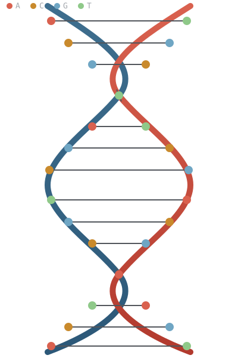

# ModelDB



DNA-inspired data-storage and AI-infrastructure research: a conversational data engine for AI models and databases, an embeddable encrypted key-value store for mobile and wearables, and a DNA-inspired compression engine for ML model weights. Three projects, one underlying idea — encode information the way biological systems do (four-symbol alphabets, content-addressed redundancy, density over raw speed) — applied to three different problems.

**[📖 Live site & documentation →](https://saji1970.github.io/ModelDB/)** · **[🧬 DNA-inspired storage & quantum computing whitepaper →](DNA-STORAGE-WHITEPAPER.md)**

## Projects in this repo

### [MDC — Molecular Data Center](mdc/) · [docs](https://saji1970.github.io/ModelDB/platform.html)

A conversational data engine that stores AI models, images, documents, and ordinary database tables side by side — queried entirely in plain sentences, no SQL required. An LLM proposes an interpretation; a deterministic validator, never the LLM itself, decides what operation actually reaches storage.

- **Store anything:** objects classified by content and tiered HOT / WARM / COLD / ARCHIVE; tensor-level model access (retrieve one layer without touching the rest of the checkpoint); an ARCHIVE tier that encrypts with AES-256-GCM and then encodes to A/C/G/T, with error correction and a corruption simulator (see the whitepaper above).
- **Databases and tables:** unlimited isolated databases, typed tables, universal `find` across all of them.
- **Import and export:** in from a Markdown design document, CSV, SQL script (parsed, never run), Mermaid ER diagram or an MDC export; out as CSV, SQL, Excel, a design document with an ER diagram, or an MDC export file. Schemas can also be proposed from a prompt or a pasted ER diagram and are created on `yes`.
- **Agent state streams:** event sourcing — a base state plus timestamped changes, rebuilt exactly as of any time, sealed per stream.
- **Safe deletes:** drop a database or table, delete a row or stream, only after it shows what would be lost.
- **Storage Explorer and API:** a browser app with a chat panel, and a bearer-token REST API with four roles, open to third-party NLU (RASA or custom); Docker and Railway deployment.

```bash
cd mdc && pip install -r requirements.txt && mdc token issue my-integration && python -m mdc serve
```

### [mdc-lite](mdc-lite/) · [docs](https://saji1970.github.io/ModelDB/docs.html) · [latest release](https://github.com/saji1970/ModelDB/releases/latest)

The embeddable counterpart, for the places a server can't reach — a watch face, a phone app, a background service. Mobile/wearable-only: no CLI, no desktop app, no AI model storage (that's MDC's job) — just small generic objects. A 348 KB encrypted key-value store in Rust: XChaCha20-Poly1305 for every value *and* every key name, then DNA-encoded (the same A/C/G/T model as MDC's archive tier) before it touches disk, a 5-function C ABI, real cross-platform builds (macOS, Windows, Android — iOS/watchOS build from source, documented why; the macOS/Windows builds exist for desktop-companion-app embedding and a planned MDC Platform CLI bridge, not because mdc-lite is itself a desktop product).

### [MemCell](MEMCELL.md) — a DNA-inspired compression engine

A multi-stage lossless compression engine optimized for ML model storage, whose pipeline is explicitly modeled on DNA and cellular information storage — a pattern-genome codebook standing in for DNA's codon table, byte-plane transposition modeled on chromosome sorting, delta encoding modeled on neural adaptation. Self-contained C++17, zero external dependencies, reaching up to 88% reduction on repeated structures. See the [whitepaper](DNA-STORAGE-WHITEPAPER.md#15-memcells-own-bio-inspired-lineage) for how its biological framing maps to its actual pipeline stages.

## License

Apache License 2.0 for MDC and mdc-lite (see each project's own `LICENSE`). See [MEMCELL.md](MEMCELL.md) for MemCell's terms.
